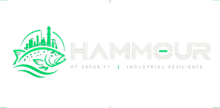
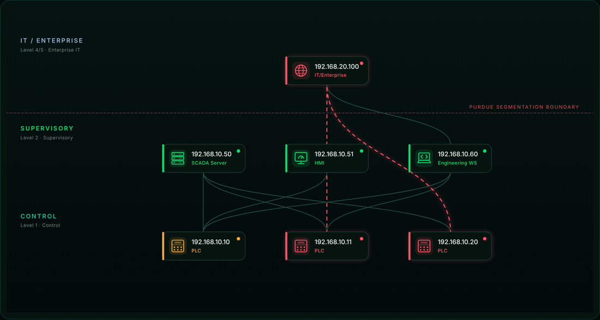
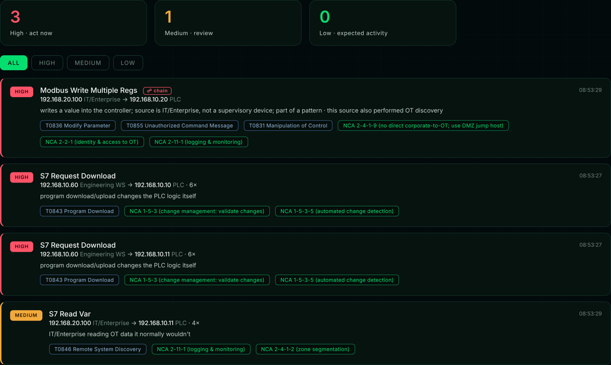
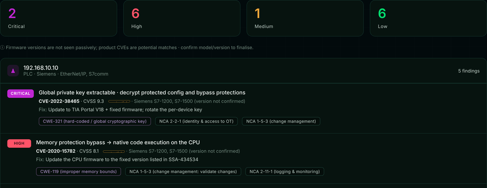

<div align="center">



# HAMMOUR

### Passive OT/ICS Security Platform — map, hunt and assess an industrial network from a single PCAP.

[](https://www.python.org/)
[](#)


*Who is on the network? · What dangerous thing is happening? · What is vulnerable?*
**All from one capture. Zero packets sent to the network.**

</div>

---

## 🛰️ What is HAMMOUR?

Industrial networks — power, water, oil, manufacturing — run on devices (PLCs, SCADA, HMIs) built for reliability, **not security**. Their protocols often have no authentication and no encryption, and active scanning can crash fragile equipment.

**HAMMOUR is 100% passive.** It reads a copy of the traffic (a PCAP) and never transmits a single packet, then answers three questions through three modules:

| 🧩 Module | Question | What it does |
|-----------|----------|--------------|
| 🗺️ **Map** | *Who is on the network?* | Discovers assets, classifies each device (PLC / SCADA / HMI / Engineering WS / IT / External) with confidence + evidence, and flags **Purdue segmentation violations**. |
| 🎯 **Hunt** | *What's dangerous?* | Decodes OT commands (S7comm, Modbus, DNP3, EtherNet/IP), runs rules + a **behavioural baseline**, and correlates attack chains. |
| 🛡️ **Vuln** | *What's vulnerable?* | Matches assets to **real CVEs** + protocol weaknesses, prioritised by CVSS + KEV + criticality. |

Every finding is mapped to **MITRE ATT&CK for ICS** and **NCA OTCC** controls, folded into a single **security posture score (0–100)**, and exportable as a **one-click compliance report**.

---

## 📸 Screenshots

<div align="center">

**Map — Purdue-layered network - shape = role, colour = risk**


**Hunt — prioritised threats mapped to ATT&CK + NCA** &nbsp;·&nbsp; **Vuln — CVEs + weaknesses**
 

</div>

---

## 💡 The idea in one line

> **Access opens the door, a vulnerability breaks the lock, an attack walks in.**

Three different questions, kept in three modules:

- **Exposure** (Map) — a path *could* exist (IT → PLC).
- **Threat** (Hunt) — someone is *doing* something dangerous now.
- **Vulnerability** (Vuln) — the device carries a *known flaw* (CVE).

**Passive server detection:** the server (PLC) listens on a fixed low port (502, 102); the client (SCADA) gets a random high port — so `min(src_port, dst_port)` is the server. One comparison separates controllers from supervisors, with no probing.

---

## 🚀 Quick start

```bash
pip install -r requirements.txt

# Web app — upload a .pcap in the browser
python app.py            #  →  http://127.0.0.1:5000

# Or the command line
python hammour_map.py capture.pcap      # full page (Map + Hunt + Vuln)
python hammour_hunt.py capture.pcap     # hunt.json
python hammour_vuln.py capture.pcap     # vuln.json
```

No capture handy? Generate a synthetic factory:

```bash
python generate_sample_pcap.py          #  →  sample_factory.pcap
```

Or use real public ICS captures: **ITI/ICS-Security-Tools**, **4SICS**, **ICS-PCAP-Challenges**.

---

## 🔬 How it works

```
PCAP → parse (Scapy) → asset inventory + comm graph → classify (evidence scoring)
     → network.json → Map · Hunt · Vuln → posture + one-click NCA report
```

- **Hunt baseline (two layers):** a *role* layer (a control command from a non-supervisory source is unauthorised) and a *behavioural* layer (first 20% of the capture is a learning window; a known device doing something new is flagged).
- **Device fingerprinting:** EtherNet/IP *List Identity* and Modbus *Read Device ID* recover model/firmware and upgrade CVEs from *potential* to *confirmed*.

---

## 📂 Project structure

```
hammour/
├── app.py                  # Flask web app (upload → Map + Hunt + Vuln)
├── hammour_map.py          # discovery + role classification + fingerprinting
├── hammour_hunt.py         # threat detection (rules + baseline + chains)
├── hammour_vuln.py         # vulnerability matching
├── render_map.py           # branded UI (Map/Hunt/Vuln tabs + report)
├── advisories.json         # seeded CVE + weakness database
├── generate_sample_pcap.py # makes a synthetic test capture
├── sample_factory.pcap     # sample capture to try immediately
├── requirements.txt
└── docs/                   # logo + screenshots
```

---

## ⚠️ Limitations (by design, stated honestly)

- **Passive only** — truly silent (ARP-only) devices stay Unknown.
- **Firmware** isn't always visible → product CVEs are *potential* until confirmed.
- Deep command decode for **S7comm / Modbus / DNP3 / EtherNet-IP**; other protocols as generic access.
- Advisory DB is **seeded with real CVEs** and refreshable from CISA CSAF.

---

## 📚 References

- **NCA OTCC** — Operational Technology Cybersecurity Controls
- **MITRE ATT&CK for ICS**
- Real CVEs used: CVE-2020-15782, CVE-2022-38465 (Siemens S7), CVE-2021-22779 (Schneider Modicon), CVE-2021-22681 (Rockwell Logix), CVE-2015-5374 (Siemens SIPROTEC · CISA KEV)

---

<div align="center">

Built by **[Your Name]** — OT/ICS Security · Industrial Resilience

⭐ If this is useful, consider starring the repo.

</div>
